# Mini Redis의 메모리 속 들여다보기

이 프로젝트의 자료구조를 **하나의 예시 저장소**로 살펴보는 그림 설명서입니다.
직접 구현한 자료구조는 해시맵, 이중 연결 리스트, 최소 힙 세 종류이며,
`MiniRedis`는 이들을 다섯 개의 인스턴스로 조합합니다.

Mermaid를 지원하는 Markdown 미리보기에서 아래 코드 블록이 다이어그램으로
표시됩니다. GitHub에서도 파일을 열어 볼 수 있습니다.
화살표는 해당 그림에 표시된 참조·연결·처리 방향을 뜻합니다.

## 1. 모든 그림의 출발점: 예시 데이터

시간이 흐르는 영향을 없애기 위해 현재 시각을 `1000.0초`로 고정합니다.
숫자는 만료 계산을 쉽게 보기 위한 예시 시각이며, 실제 기본 시계는 `time.time()`입니다.
아래 코드는 프로젝트 루트에서 Python으로 실행할 수 있습니다.

```python
from mini_redis.core import MiniRedis

redis = MiniRedis(clock=lambda: 1000.0)

redis.set("name", "Yeji")
redis.set("age", "25")
redis.set("city", "Seoul")
redis.set("score", "100")
redis.set("token", "abc")
redis.get("name")

redis.expire("name", 60)
redis.expire("age", 20)
redis.expire("city", 40)
redis.expire("score", 30)
redis.expire("token", 10)
redis.expire("token", 90)  # token의 만료를 연장
```

| Key | 문자열 Value | 현재 만료 시각 | 남은 TTL |
|---|---|---|---|
| name | Yeji | 1060.0 | 60초 |
| age | 25 | 1020.0 | 20초 |
| city | Seoul | 1040.0 | 40초 |
| score | 100 | 1030.0 | 30초 |
| token | abc | 1090.0 | 90초 |

`token`의 예전 만료 기록 `1010.0`도 힙에는 남아 있습니다. 이것이 왜 필요한지는
[TTL 처리 그림](#7-시간이-지나면-두-자료구조가-협력한다)에서 확인할 수 있습니다.

## 2. 전체 지도: 다섯 자료구조의 역할

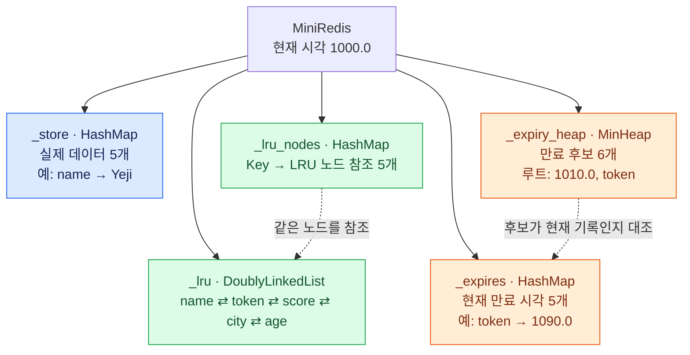

연결 코드는 [mini_redis/core.py](mini_redis/core.py)에 있습니다.
세 해시맵은 서로 다른 객체이며 각각 자기 버킷 배열과 충돌 체인을 가집니다.

## 3. `_store`: 버킷 배열 + 충돌 체인

구현: [mini_redis/hash_map.py](mini_redis/hash_map.py)

해시맵은 문자열 Key를 숫자로 바꾸고, `해시값 % 버킷 수` 위치에 저장합니다.
이 예시에서는 `_capacity = 8`, `_size = 5`입니다.
아래 버킷 위치는 프로젝트의 실제 해시 함수로 계산한 결과입니다.

| Key | 해시값 | `% 8` 결과 |
|---|---:|---:|
| score | 220699440 | 0 |
| age | 136705 | 1 |
| token | 223175489 | 1 |
| name | 5708757 | 5 |
| city | 5162805 | 5 |

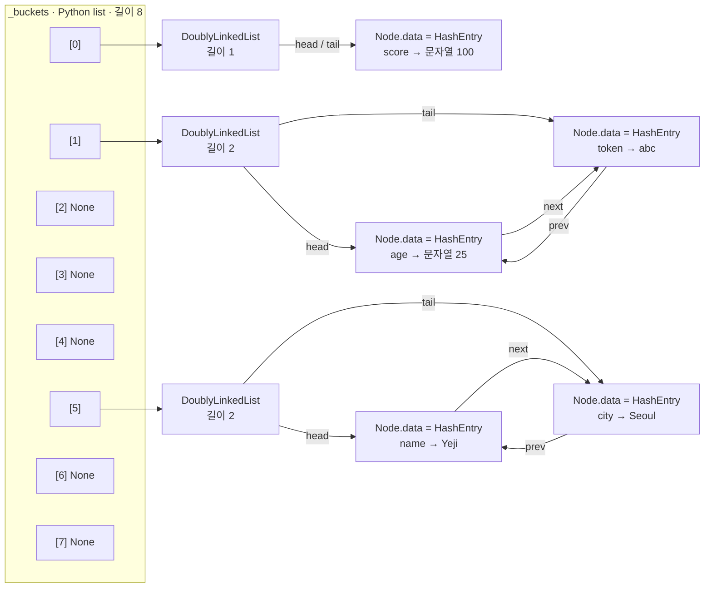

`age`와 `token`은 같은 버킷에 들어갑니다. 충돌해도 값을 덮어쓰지 않고
**이중 연결 리스트로 이어 붙입니다.** `GET token`은 1번 버킷의 `age`를 거쳐
`token`을 찾습니다. 각 체인의 `head.prev`와 `tail.next`는 `None`입니다.

해시는 UTF-8 바이트마다 `(이전 값 × 37 + 바이트) & 0xFFFFFFFF`로 누적합니다.
항목 수 / 버킷 수가 `0.75`를 **초과**하면 버킷 수를 두 배로 늘리고 재배치합니다.
아래는 버킷 수가 16으로 늘어났을 때 기존 두 Key의 위치를 비교한 별도 그림입니다.

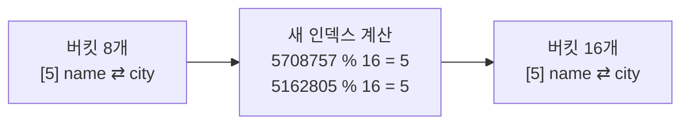

버킷이 늘어도 모든 충돌이 사라지지는 않습니다. 실제로 재배치할 때는
모든 Key의 인덱스를 새 버킷 수로 다시 계산합니다.

## 4. `_lru`: 최근 사용 순서를 잇는 이중 연결 리스트

구현: [mini_redis/linked_list.py](mini_redis/linked_list.py)

`SET`과 성공한 `GET`이 해당 Key를 맨 앞으로 옮깁니다. 예시의 마지막 조회가
`GET name`이므로 `name`이 가장 최근입니다. `EXPIRE`는 이 순서를 바꾸지 않습니다.

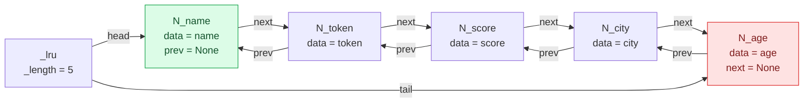

왼쪽 `head`는 가장 최근 사용한 Key, 오른쪽 `tail`은 가장 오래 사용하지 않은
Key입니다. 메모리 한도를 넘으면 `tail`부터 제거합니다.
`N_name` 같은 이름은 그림에서 노드를 구별하기 위한 표기입니다.

노드 하나를 확대하면 다음과 같습니다. `_owner`는 그 노드가 소속된 리스트를
가리키며, 다른 리스트의 노드를 잘못 제거하거나 이동하지 않도록 확인할 때 씁니다.

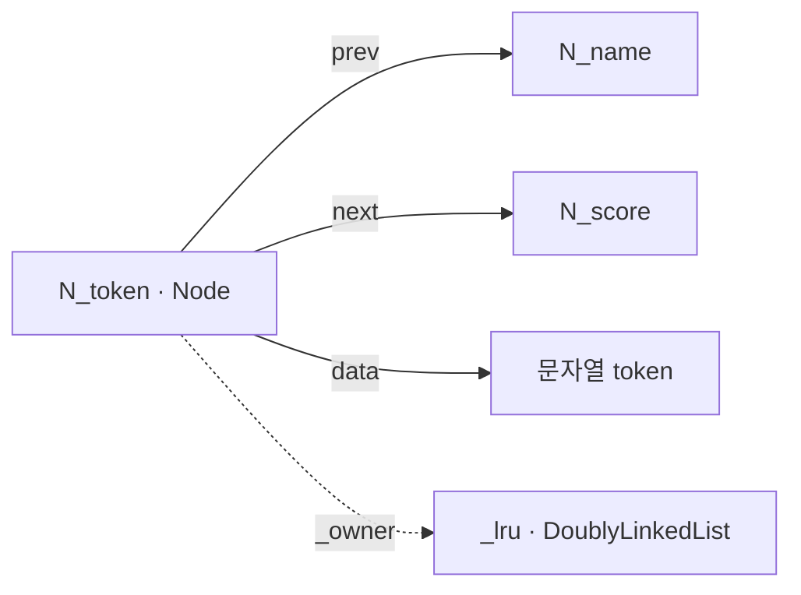

같은 `Node` 구현을 해시 충돌 체인에도 사용하지만, 그때 `data`는 `HashEntry`,
`_owner`는 해당 버킷의 리스트입니다. **해시 체인 노드와 LRU 노드는 별개입니다.**

## 5. `_lru_nodes`: Key로 바로 노드를 찾는 해시맵

`_lru`만 있으면 특정 Key의 노드를 찾으려고 앞에서부터 순회해야 합니다.
`_lru_nodes`는 **노드 객체의 참조**를 저장하므로 찾은 노드를 바로 이동할 수 있습니다.
아래 해시맵 그림은 각 체인의 `Node.data`에 담긴 `HashEntry`를 펼쳐 보여 줍니다.
빈 버킷 `[2, 3, 4, 6, 7]`과 체인을 감싸는 리스트 객체는 생략했습니다.

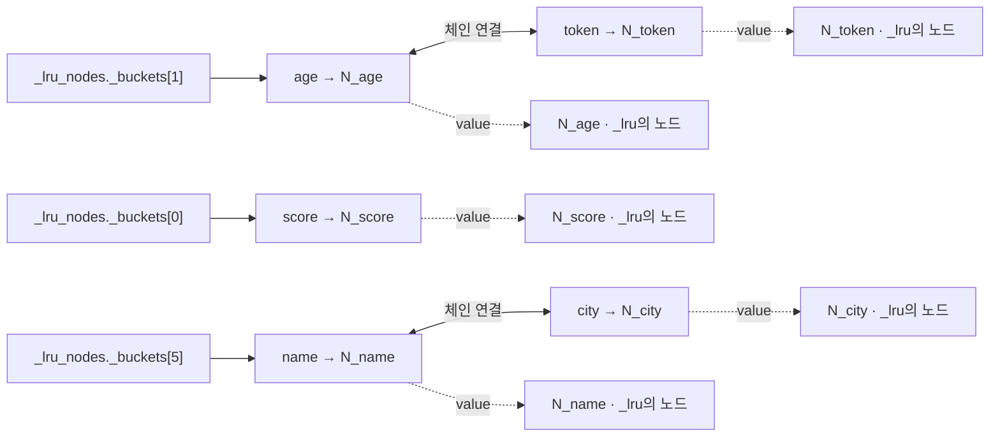

예시 상태에서 추가로 `GET city`를 하면 같은 `N_city` 객체를 떼어 맨 앞으로
옮깁니다. 새 LRU 노드를 만들지 않으며, `_lru_nodes`의 참조도 그대로입니다.

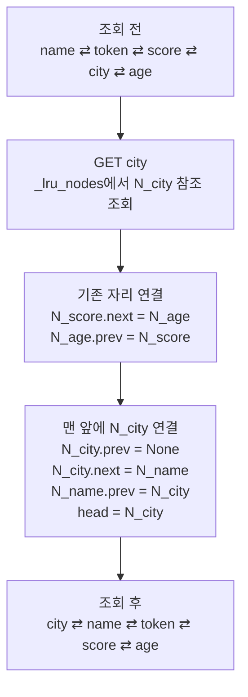

해시맵 조회는 평균 O(1), 노드를 이미 찾은 뒤의 리스트 이동·제거는 O(1)입니다.
해시 충돌 체인이 길어지면 조회 시간이 늘어날 수 있습니다.

## 6. TTL: 현재 만료 시각과 최소 힙

이 절부터는 다시 1절의 원래 예시 상태입니다. 앞 절의 추가 `GET city`는
동작 설명만을 위한 독립적인 예시입니다.

### `_expires`: 지금 유효한 만료 시각

이것도 같은 `HashMap` 구현입니다. Value만 문자열이나 노드 참조가 아닌
만료 시각 숫자입니다. 빈 버킷과 리스트 객체는 앞 절처럼 생략했습니다.

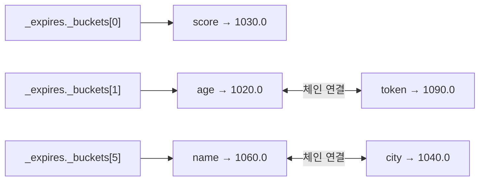

`EXPIRE token 90`은 이 해시맵의 기존 `token` 값을 `1010.0 → 1090.0`으로
덮어씁니다. TTL이 없는 Key는 이 해시맵에 항목이 없습니다.

### `_expiry_heap`: 가장 이른 후보가 꼭대기에 있는 트리

구현: [mini_redis/min_heap.py](mini_redis/min_heap.py)

각 항목은 `(만료 시각, Key)` 튜플입니다. 부모는 자식보다 작거나 같으며,
따라서 루트가 전체에서 가장 작은 항목입니다. 동일 시각이면 Key의 문자열
순서로 비교합니다. **형제끼리, 또는 배열 전체가 정렬된 것은 아닙니다.**

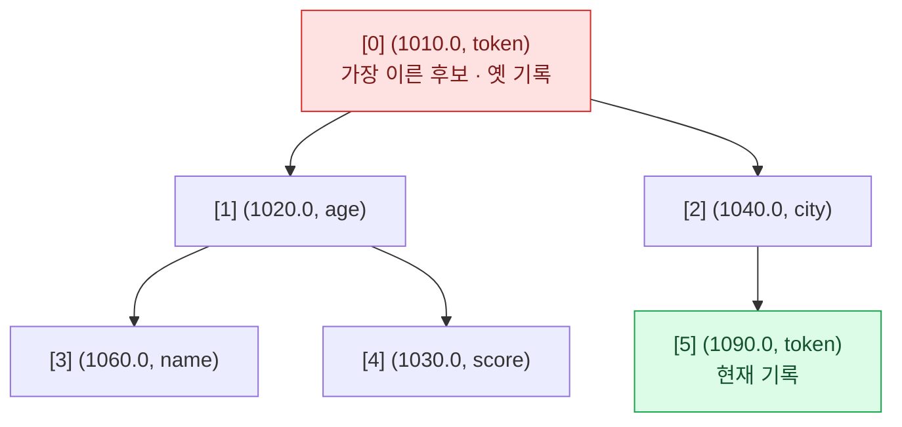

`1010.0`이 옛 기록이라는 사실은 `_expires`와 대조해야 알 수 있습니다.
힙 자체는 유효성을 구별하지 않고 작은 튜플을 루트에 유지합니다.

### 같은 힙을 실제 저장 형태인 배열로 보기

위 트리는 관계를 그린 것입니다. 실제 구현에는 트리 노드나 자식 포인터가 없고,
Python `list`인 `_items` 하나에 튜플을 저장합니다.

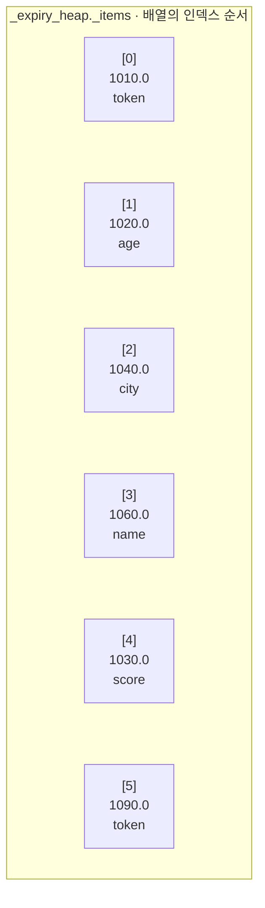

인덱스 `i`의 부모는 `(i - 1) // 2`, 왼쪽 자식은 `2*i + 1`, 오른쪽 자식은
`2*i + 2`입니다. 배열 범위를 벗어나는 자식은 없습니다.
예를 들어 `[1] age`의 자식은 `[3] name`과 `[4] score`입니다.

`push`는 배열 끝에 붙이고 부모와 비교하며 올라갑니다. `pop`은 루트를 꺼내고
마지막 항목을 루트로 옮긴 뒤 더 작은 자식과 비교하며 내려갑니다.
루트 확인 `peek`는 O(1), 삽입·제거는 O(log n)입니다.

## 7. 시간이 지나면 두 자료구조가 협력한다

이제 시계가 `1025.0`이 된 상황을 가정합니다. 백그라운드 타이머는 없으며,
다음 명령이 `_purge_expired()`를 호출할 때 아래 처리가 일어납니다.

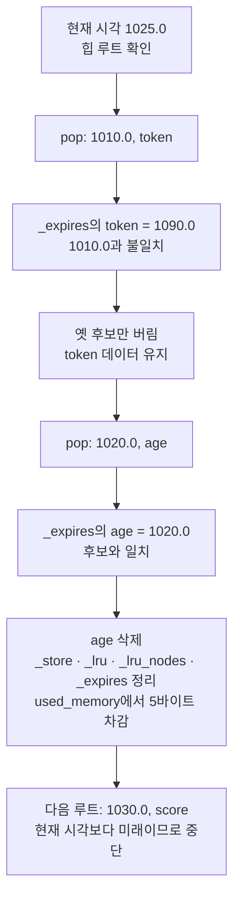

옛 후보를 버리는 것을 지연 삭제라고 합니다. `EXPIRE`로 시간을 바꾸거나,
`SET`으로 TTL을 초기화하거나, `DEL`·LRU 제거로 Key를 지워도 기존 힙 항목을
즉시 찾아 지우지는 않습니다. 그 후보의 시간이 되었을 때 대조해 버립니다.
후보를 꺼낼 때마다 힙은 다시 정돈됩니다. 위 처리 후 상태는 다음과 같습니다.

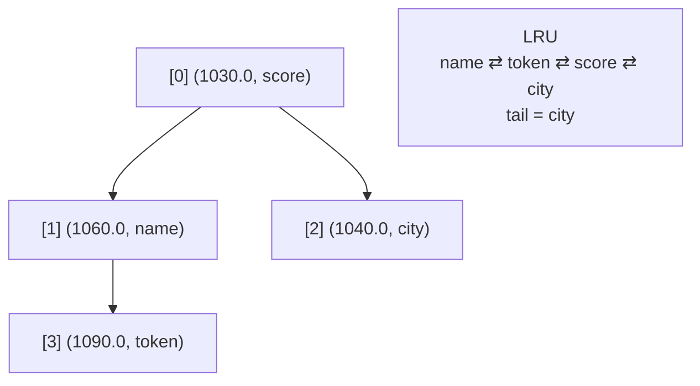

저장된 Key는 4개, 힙 후보도 4개이며 `used_memory`는 `38 → 33`바이트입니다.

## 8. 메모리 제한과 LRU 제거 연결하기

다시 1절의 상태에서 시작하는 **별도의 예시**입니다.
`CONFIG SET maxmemory 35`만으로는 Key가 제거되지 않습니다.
그다음 `SET name Yeji`를 실행하면 사용량이 38바이트이므로 가장 오래된 `age`를
제거해 33바이트로 줄입니다. 이 `SET`은 `name`의 TTL도 초기화합니다.

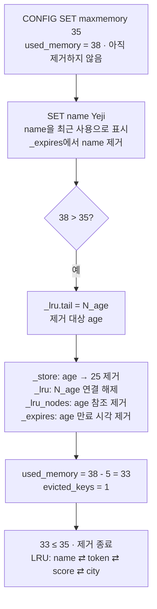

이 예시에서 힙은 여전히 6개 후보를 보관합니다. 삭제된 `age`, TTL이 초기화된
`name`, 연장 전 `token`의 옛 후보는 나중에 만료 검사에서 버립니다.

메모리 관련 필드는 별도의 컨테이너가 아닌 숫자입니다. 최초 예시에서는
`_used_memory = 38`, `_maxmemory = 0`(무제한), `_evicted_keys = 0`입니다.
사용량은 Key와 Value의 UTF-8 바이트 길이만 합산합니다.

| 항목 | Key 바이트 | Value 바이트 | 합계 |
|---|---:|---:|---:|
| name → Yeji | 4 | 4 | 8 |
| age → 25 | 3 | 2 | 5 |
| city → Seoul | 4 | 5 | 9 |
| score → 100 | 5 | 3 | 8 |
| token → abc | 5 | 3 | 8 |
| **전체** | **21** | **17** | **38** |

버킷 배열, 노드, 참조, 만료 기록 등 Python 객체 자체의 메모리는 이 계산에
포함하지 않습니다. TTL 만료와 직접 `DEL`은 `evicted_keys`를 증가시키지 않습니다.

## 9. 코드와 그림 연결하기

| 코드의 구성 요소 | 그림에서의 모습 | 저장 내용 |
|---|---|---|
| `HashMap` × 3 | 버킷과 충돌 체인 | `_store`, `_lru_nodes`, `_expires` |
| `HashMap._buckets` | 인덱스가 붙은 배열 | `None` 또는 버킷의 `DoublyLinkedList` 참조 |
| `HashEntry` | `Key → Value` 상자 | 문자열 Key와 해당 해시맵의 Value |
| `DoublyLinkedList` | 양방향 화살표로 이은 노드 | 각 해시 버킷의 체인, 또는 `_lru` 순서 |
| `Node` | `prev`, `next`, `data`, `_owner`를 가진 상자 | 체인에서는 `HashEntry`, LRU에서는 Key |
| `MinHeap` | 완전 이진 트리와 그에 대응하는 배열 | `_expiry_heap`의 만료 후보 |
| `MinHeap._items` | 인덱스 순서로 나열한 Python `list` | `(float 만료 시각, str Key)` 튜플 |

CLI가 명령을 나눈 `tokens`·`arguments`, `keys()` 결과, 출력용 `lines`도 Python
`list`입니다. 이들은 명령 처리 중의 임시 목록이며 위 저장소 상태를 유지하는
자료구조와 구분됩니다. 예를 들어 명령 파싱은 다음과 같습니다.

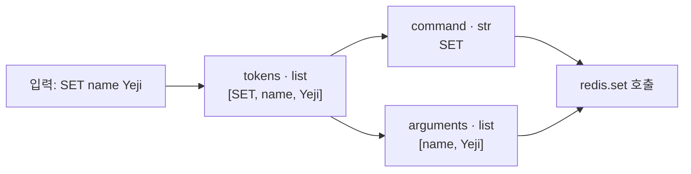

CLI 파싱과 응답은 [mini_redis/cli.py](mini_redis/cli.py), 실행 진입점은
[main.py](main.py)에서 확인할 수 있습니다.
