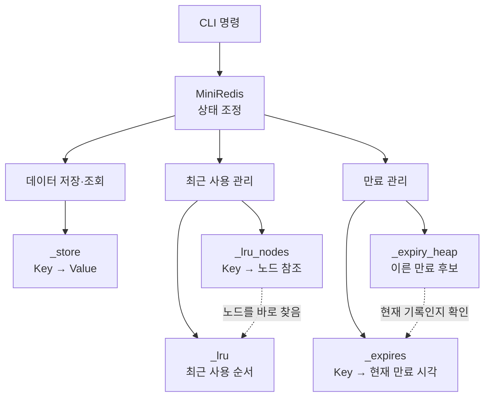

# Mini Redis

Mini Redis는 외부 패키지 없이 Python의 기본 기능과 표준 라이브러리로 만든
CLI 기반 인메모리 Key-Value 저장소입니다. 실제 Redis 서버를 재현하기보다
Redis 스타일의 핵심 동작을 단순화해 구현한 학습 프로젝트입니다.

체이닝 해시맵, 이중 연결 리스트와 최소 힙을 직접 구현하고 조합했습니다.
해시맵은 데이터 저장·조회, 연결 리스트는 LRU 사용 순서, 최소 힙은 TTL 만료
후보 관리를 담당하며, 세 자료구조가 하나의 저장소에서 함께 동작하는 과정을
코드로 이해하는 데 초점을 맞췄습니다.

## 주요 기능

| 구분 | 지원 기능 |
|---|---|
| 기본 명령 | `SET`, `GET`, `DEL`, `EXISTS`, `DBSIZE`, `KEYS` |
| 메모리 관리 | `CONFIG SET maxmemory`, `INFO memory`, LRU 자동 제거 |
| 만료 관리 | `EXPIRE`, `TTL`, 최소 힙 기반 만료 처리 |
| CLI | `mini-redis>` REPL, 따옴표를 이용한 공백 포함 값, Redis 스타일 결과와 오류 |
| 핵심 자료구조 | 직접 구현한 체이닝 해시맵, 이중 연결 리스트, 최소 힙 |

## 구조

### 폴더 및 파일 구조

```text
B5-1.py-mini-redis/
├── main.py                     # Mini Redis CLI 실행 진입점
├── mini_redis/                 # 애플리케이션 코드
│   ├── __init__.py
│   ├── cli.py                  # 명령어 파싱, 검증과 REPL 실행
│   ├── core.py                 # 저장 명령과 LRU·메모리·TTL 상태 관리
│   ├── hash_map.py             # 체이닝 방식의 해시맵
│   ├── linked_list.py          # 이중 연결 리스트
│   └── min_heap.py             # TTL 만료 순서를 관리하는 최소 힙
├── scripts/
│   └── evaluation_demo.py      # 주요 기능을 한 번에 실행하는 데모
├── tests/                      # 기능과 자료구조 자동 테스트
└── README.md                   # 프로젝트 설명과 사용 방법
```

### 실행 흐름

Mini Redis는 다음과 같은 흐름으로 구성되어 있습니다.

```text
사용자 명령
    ↓
CLI 입력 해석 및 검증
    ↓
Mini Redis 명령 처리
    ├─ 해시맵: Key-Value 저장과 조회
    ├─ 이중 연결 리스트: LRU 사용 순서 관리
    ├─ 최소 힙: TTL 만료 순서 관리
    └─ 메모리 관리: 사용량 계산과 LRU 제거
    ↓
Redis 스타일 결과 출력
```

### `MiniRedis`가 사용하는 다섯 핵심 자료구조

| 변수 | 자료구조 | 저장하는 내용 | 역할 |
|---|---|---|---|
| `_store` | 해시맵 | Key → 문자열 값 | 실제 데이터 저장과 조회 |
| `_lru` | 이중 연결 리스트 | 최근 사용 순서의 Key 노드 | 앞에는 최근 사용 Key, 뒤에는 가장 오래 사용하지 않은 Key 유지 |
| `_lru_nodes` | 해시맵 | Key → `_lru`의 노드 참조 | 이동하거나 제거할 LRU 노드를 순회 없이 찾기 |
| `_expires` | 해시맵 | Key → 현재 유효한 만료 시각 | TTL 조회와 만료 기록의 유효성 확인 |
| `_expiry_heap` | 최소 힙 | `(만료 시각, Key)` | 가장 이른 만료 후보 찾기 |



`_lru_nodes`는 `_lru`를 포함하는 구조가 아니라 `_lru`에 속한 노드를
참조하는 별도의 해시맵입니다. 마찬가지로 `_expires`와 `_expiry_heap`도
포함 관계가 아닙니다. 만료 시간이 다시 설정되거나 삭제되면 힙에 예전 기록이
남을 수 있으므로, `_expires`의 현재 만료 시각과 일치하는 기록만 유효한 것으로
처리합니다.

## 요구 환경

- Python 3.8 이상

외부 패키지는 필요하지 않습니다.

## 실행 및 사용 방법

프로젝트 디렉터리에서 다음 명령으로 실행합니다.

```bash
python3 main.py
```

실행 후 `mini-redis>` 프롬프트에서 명령을 입력합니다. 명령은 대소문자를
구분하지 않으며, 공백이 포함된 값은 큰따옴표로 감쌀 수 있습니다.

### 지원 명령어

아래 표에서 `key`와 `value`는 원하는 문자열로 바꾸어 입력합니다. `bytes`와
`seconds`에는 정수를 입력합니다.

| 명령어 형식 | 사용 예시 | 설명 |
|---|---|---|
| `SET key value` | `SET name Alice` | Key에 문자열 Value를 저장합니다. 기존 Key이면 Value를 덮어씁니다. |
| `GET key` | `GET name` | Key의 Value를 조회합니다. 없는 Key이면 `(nil)`을 출력합니다. |
| `DEL key` | `DEL name` | Key를 삭제합니다. 삭제하면 1, 없는 Key이면 0을 출력합니다. |
| `EXISTS key` | `EXISTS name` | Key가 있으면 1, 없으면 0을 출력합니다. |
| `DBSIZE` | `DBSIZE` | 현재 저장된 Key 개수를 출력합니다. |
| `KEYS` | `KEYS` | 현재 저장된 모든 Key를 출력합니다. `KEYS *`는 지원하지 않습니다. |
| `CONFIG SET maxmemory bytes` | `CONFIG SET maxmemory 100` | 메모리 제한을 바이트 단위로 설정합니다. 0은 제한 없음입니다. |
| `INFO memory` | `INFO memory` | 현재 사용량, 메모리 제한과 LRU 제거 횟수를 출력합니다. |
| `EXPIRE key seconds` | `EXPIRE name 60` | Key가 지정한 초 뒤에 만료되도록 설정합니다. |
| `TTL key` | `TTL name` | Key의 남은 만료 시간을 초 단위로 출력합니다. |
| `quit` 또는 `exit` | `quit` | Mini Redis를 종료합니다. |

Value에 공백이 들어가면 다음과 같이 큰따옴표로 감쌉니다.

```text
mini-redis> SET greeting "Hello Mini Redis"
OK
mini-redis> GET greeting
"Hello Mini Redis"
```

### 수동 테스트 예시

다음 명령을 위에서부터 차례로 입력하면 저장, 조회, TTL과 메모리 정보를
직접 확인할 수 있습니다.

```text
mini-redis> CONFIG SET maxmemory 100
OK
mini-redis> SET name "Alice Smith"
OK
mini-redis> GET name
"Alice Smith"
mini-redis> EXPIRE name 60
(integer) 1
mini-redis> TTL name
(integer) 59
mini-redis> INFO memory
used_memory:15
maxmemory:100
evicted_keys:0
mini-redis> quit
```

`exit` 또는 `quit`을 입력하면 종료합니다. `TTL` 결과는 명령 실행 시점에 따라
달라질 수 있습니다.

### EXPIRE와 TTL 응답

| 상황 | 응답 | 의미 |
|---|---|---|
| 없는 Key에 `EXPIRE` | `(integer) 0` | 만료 시간을 설정하지 못함 |
| 존재하는 Key에 양수 `EXPIRE` | `(integer) 1` | 만료 시각을 설정함 |
| 존재하는 Key에 0 이하 `EXPIRE` | `(integer) 1` | Key를 즉시 삭제함 |
| 없는 Key의 `TTL` | `(integer) -2` | Key가 존재하지 않음 |
| TTL이 설정되지 않은 Key의 `TTL` | `(integer) -1` | Key는 존재하지만 만료되지 않음 |
| TTL이 설정된 Key의 `TTL` | `(integer) N` | 남은 시간 `N`초 |

## 주요 동작과 제약

- `maxmemory`가 `0`이면 메모리 제한이 없습니다.
- 메모리 사용량은 Key와 Value의 UTF-8 바이트 길이 합으로 계산하며 자료구조
  자체의 오버헤드는 포함하지 않습니다.
- 설정 변경만으로 Key를 제거하지 않습니다. `SET` 후 한도를 초과하면 LRU
  순서로 자동 제거합니다.
- 단일 Key-Value 크기가 한도보다 크면 저장하지 않고 OOM 오류를 반환합니다.
- 같은 Key에 다시 `SET`하면 값을 덮어쓰며 Key 개수는 증가하지 않습니다.
- `SET`으로 기존 Key를 덮어쓰면 이전 TTL을 초기화합니다.
- 만료된 Key는 백그라운드 작업이 아니라 다음 명령에서 만료 힙을 확인할 때
  정리됩니다.
- `KEYS`는 패턴 검색과 정렬을 지원하지 않습니다.

## 검증

자동 테스트는 다음 명령으로 실행합니다.

```bash
python3 -B -m unittest discover -s tests -v
```

현재 Python 3.9.6에서 전체 테스트 63개가 통과했습니다. Python 3.12.3에서도
실행과 테스트를 검증한 이력이 있습니다. 검증 범위는 다음과 같습니다.

- 세 자료구조의 필수 연산, 경계 조건, 해시 충돌과 버킷 확장
- 기본 명령과 Redis 스타일 출력
- LRU 순서, 메모리 계산, 자동 제거와 OOM
- TTL 설정·초기화·만료 및 관련 상태 정리
- CLI 파싱, 오류 메시지, 프롬프트와 종료
- 위 기능을 함께 사용하는 통합 시나리오

실제 `main.py` 실행에서도 프롬프트, 명령 처리, LRU 제거, 즉시 만료, 오류
출력과 종료를 확인했습니다.

### 주요 기능 한 번에 시연하기

기본 명령, LRU 자동 제거, 메모리 정보, TTL과 에러 처리를 차례로 시연하려면
다음 명령을 실행합니다.

```bash
python3 scripts/evaluation_demo.py
```

각 기능은 독립된 저장소 상태로 실행되며 명령, 실행 결과와 검증 성공 여부를
함께 출력합니다. TTL 시연은 기다리는 시간을 줄이고 실행 결과를 일정하게
유지하기 위해 모의 시각을 사용하며, 시각을 진행할 때 그 내용을 화면에
표시합니다.
